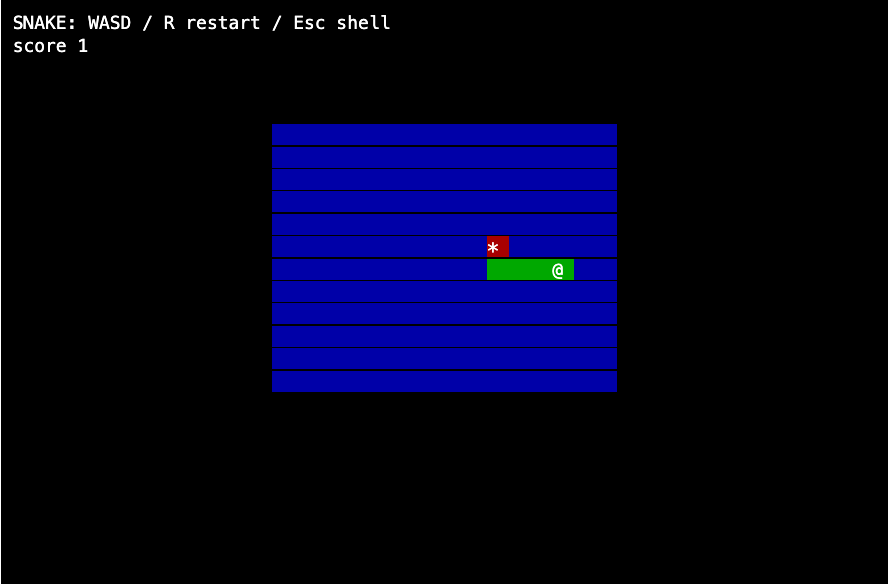
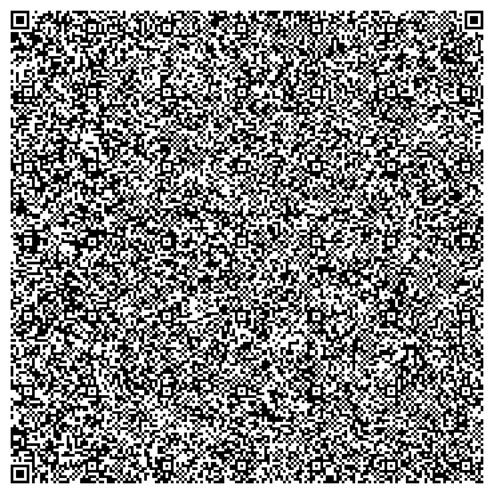

# QRnel

[デモ](https://TKY-27.github.io/QRnel/) · [English](README.md)





QRコード一枚に収まるRust製OSです。ブートローダーからカーネル、シェル、ゲーム二本を含めて**2,953バイト**。Version 40-Lのバイナリ容量を使い切っています。

ブラウザでQRを読むと中の機械語をv86が実行します。画像ファイルや付属のサンプルからも起動できます。画面をクリックしてシェルに直接入力してください。

## 起動

ビルド後に`make serve`を実行してSafariかChromiumで http://127.0.0.1:4173 を開きます。カメラはlocalhostかHTTPSで使えます。前面カメラのプレビューは鏡映表示です。QRの読み取りには反転前の画像を使います。カメラの許可を断っても「Open image」からQR画像を開けます。

シェルでは英字一文字を入力してEnterを押します。Tabでゲスト画面からフォーカスを外せます。

| キー | 動作 |
| --- | --- |
| h | ヘルプ |
| t | タイマーのtick数 |
| m | 空きメモリ |
| a | 256バイト確保 |
| r | 確保した領域を回収 |
| d | TRAILを起動。矢印キーで操縦 |
| s | Snakeを起動。WASDで移動。Rで再開 |
| c | 画面を消去 |

どちらのゲームもEscでシェルに戻れます。TRAILは矢印キーで光の軌跡を描くデモです。Snakeは餌を食べて伸びるおなじみのゲーム。壁や自分の胴体に当たったらゲームオーバーです。盤面を埋めれば勝利。やりますねぇ。

## ビルド

HomebrewとRustupを用意してこのディレクトリで実行します。

```sh
brew install nasm qemu node python
rustup toolchain install 1.99.1 --profile minimal --component llvm-tools,rustfmt --target i586-unknown-linux-gnu
npm ci
npx playwright install chromium webkit
make
```

Rustは1.99.1でNASMは3.02が必要です。Homebrewが新しいNASMを提供する場合は3.02を別途用意してください。npm依存は固定済みです。

```sh
make test     # ビルドと自動検証
make run      # QEMUで起動
make serve    # ブラウザ用のローカル配信
```

`make`を実行すると`release/`にバイナリとQR画像ができます。サイズとチェックサムは[マニフェスト](release/manifest.json)にまとめています。ブラウザはこれと照合してから起動します。ファームウェアは初回のブラウザビルドで取得して検証します。

ELFとリンカーマップ、逆アセンブルは`build/`に出力します。QR画像の再生成：

```sh
node scripts/qr-generate.mjs release/qrnel.bin
npm run verify:qr
```

## OS内部

16ビットAssemblyのローダーがBIOSから読み込まれます。32ビットx86 Protected Modeへ移ってRustカーネルを起動します。`no_std`で書いた独自実装です。VGAテキスト表示とPS/2入力を扱い、100 HzのPITで時間を数えます。AssemblyがGDTと256エントリーのIDTを設定し、Rustが割り込みを処理します。予期しない割り込みや例外では`FAULT`を表示して停止します。

メモリ管理には4 KiBのバイトアリーナを使います。範囲内で領域を確保し、足りなければ失敗を返します。シェルから256バイトずつ確保できます。`r`で回収すれば元どおりです。足りなくなったら回収して、どうぞ。

TRAILとSnakeは表示や入力のサービスを共有する別々のRustモジュールです。ゲームから戻ると一時領域を回収します。遊ぶ前にシェルで確保した分は残るので`m`で比べられます。

Snakeの盤面は16×12マスで192バイト使います。毎秒5歩進んで、餌一個で一節伸びて一点入ります。逆走する入力は無視します。同じ一歩の間に複数のキーを押した場合は最初の方向転換が有効です。その一歩で空く尻尾のマスには進めます。Rで再開できます。おっ、そうだな。

## 制約

単一タスクがring 0で動きます。プロセス分離やスケジューラーはありません。ファイルシステムもネットワークも永続保存も実装していません。画面が一周すると消去されるためスクロールバックもありません。

キーボードはUS配列の英字を想定しています。修飾キーは無視します。待ち行列に入るのは31個までで満杯なら新しい入力を捨てます。スマートフォンでもページは表示できますが操作にはキーボードが必要です。

対象はQEMUのPentium PCと指定BIOSを使うv86です。UEFIや任意の実機PCでは試していません。Rustのi586ターゲットから使うのはcoreだけです。Linuxやlibcはリンクしていません。

QRには独自のゲスト実行コードと初期化済みデータをすべて収めています。BIOSとv86、QRデコーダー、ブラウザのランチャーは外側にあります。ゲスト用の追加ファイルは読み込みません。

ブラウザはゼロ埋めの仮想フロッピーをRAMに作り、QRを復号した内容を先頭に置きます。macOSアプリの導入やGatekeeperの変更は不要です。QEMUで開発するときは`build/floppy.img`を使います。

## 検証

QEMUで割り込みやメモリ境界を調べ、シェルとゲームを操作しました。ChromiumとWebKitでも実際のv86を動かしています。QR画像を別のデコーダーで読み直した結果は全バイト一致しました。異なるディレクトリでのクリーンビルド二回も同じ結果です。

**実Macカメラでの読み取りは未確認です。** 紙か別画面にQRを大きく出して白い余白ごと撮影してください。起動後にゲームを試してください。読み取り後に撮影が止まることも確認します。自動テストの模擬映像ではピントや照明まで確かめられません。

独自コードは[MIT](LICENSE)です。外部部品は[第三者ライセンス](https://TKY-27.github.io/QRnel/third-party.html)を参照してください。
