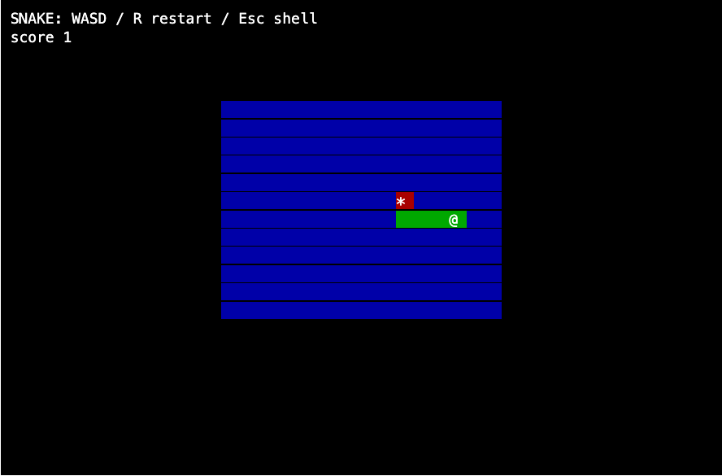
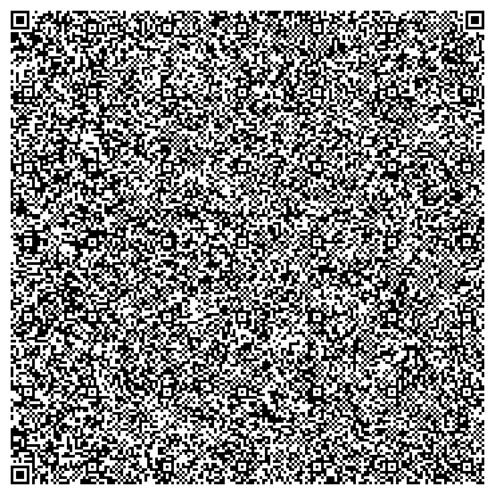

# QRnel

[Demo](https://TKY-27.github.io/QRnel/) · [日本語](README.ja.md)





A Rust operating system in one QR code. The bootloader, kernel, shell and two games occupy **2,953 bytes**, the byte-mode capacity of a Version 40-L code.

v86 boots the decoded bytes from a zero-filled RAM floppy. Scan a QR, open an image or use the sample. Click the guest screen to type. Tab releases the keyboard.

## Demo

Run `make serve` and open http://127.0.0.1:4173 in Safari or Chromium. Camera access needs localhost or HTTPS. Front-camera previews are mirrored; decoding uses the original frame.

Shell commands (letter then Enter):

| Key | Action |
| --- | --- |
| h | Help |
| t | Timer ticks |
| m | Free memory |
| a | Allocate 256 bytes |
| r | Reclaim allocations |
| d | TRAIL: steer with arrows |
| s | Snake: WASD to move, R to restart |
| c | Clear the screen |

Esc returns to the shell. Snake has food, growth, scoring and wall/body collisions. Fill the board to win. Doom will have to wait.

## Build

Install Homebrew and Rustup, then run here:

```sh
brew install nasm qemu node python
rustup toolchain install 1.99.1 --profile minimal --component llvm-tools,rustfmt --target i586-unknown-linux-gnu
npm ci
npx playwright install chromium webkit
make
```

Requires Rust 1.99.1 and NASM 3.02. If Homebrew ships a newer NASM, install 3.02 separately. npm dependencies are locked.

```sh
make test     # build, QEMU, QR round trip, browser tests
make run      # QEMU window
make serve    # local browser demo
```

`make` writes the binary and QR PNG to `release/`. Size and checksum are in the [release manifest](release/manifest.json). The browser checks decoded bytes against it before booting. The build fetches checked firmware.

## Architecture

Assembly loads the guest, sets up GDT/IDT and enters 32-bit x86 Protected Mode. The original `no_std` Rust kernel handles VGA text, PS/2 input and 100 Hz timer interrupts. A 4 KiB byte arena allocates and reclaims memory. Both games share services and reclaim temporary memory on exit.

One task runs at ring 0, without processes, a filesystem, network or persistence. The i586 target supplies core; no Linux or libc is linked. Targets are QEMU's Pentium PC and v86 with the supplied BIOS. UEFI and arbitrary physical PCs are untested.

All custom guest code and initialized data fit in the QR. BIOS firmware, v86, the decoder and launcher stay outside it. QEMU uses `build/floppy.img`.

## Verification

Tests cover interrupts, bounds, shell input and games. Independent QR decoding matches every byte. Two clean builds agree. Chromium and WebKit run the real guest.

Physical Mac camera scanning is untested. Show the QR on paper or another screen. Keep its white border. Check booting and that capture stops after decoding.

[MIT](LICENSE). [Third-party notices](https://TKY-27.github.io/QRnel/third-party.html).
